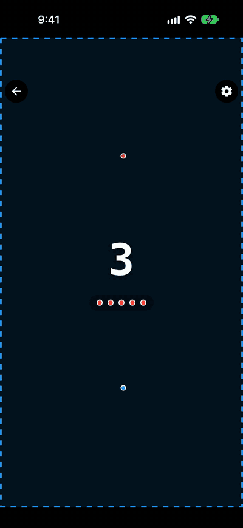

# LightCycles

A Tron-style light-cycle duel for two players on one phone, or one player against the CPU.

LightCycles is a local multiplayer arcade game: each rider leaves a solid trail behind them, and the last cycle still riding wins the round. It runs on iOS, Android, and web from one codebase. Built with Expo, React Native, and React Native Skia, it is part of a family of games built on my open-source `@tastic` game-engine and `@rific` Expo utility packages. App Store and Google Play release in progress.

<p align="center"></p>

## Features

- **Two modes:** pass-and-play two-player on a single device (players sit face to face, each steering in their own half of the screen), or one player against a CPU opponent with three difficulties (Drone, Bot, MCP).
- **Controls:** swipe to steer on touch devices; on desktop web each player picks WASD, the arrow keys, or IJKL, with conflicts swapped automatically.
- **Six powerups:** Overdrive, Stasis, Shield, Prune, Hack, and Overclock, collected from a mystery pickup and fired with a tap. Each can be toggled per match.
- **Five arenas:** Open, Pillars, Gauntlet, Portals (paired teleporters), and Underpass (a tunnel riders can cross over and under). Layouts are generated to fit the board's actual size.
- **Match options:** three grid sizes, three speeds, a trail-length setting (trails that grow forever, or a tail that follows at half or quarter rate), wrap-around edges, and a full-screen mode that extends the board into the safe area.
- **Profiles, stats, and achievements:** saved player profiles with a name, color, and key scheme; per-profile and overall stats (vs CPU by difficulty, two-player, per-color records, player rankings); and a 30-entry achievement catalog with bronze, silver, and gold tiers.
- **How-to-play guide** shown once on first launch and replayable from Settings, with copy that adapts to touch or keyboard and names each player's chosen keys.
- **Settings** for sound, haptics, appearance, an app-wide orientation lock, an iOS edge-gesture guard, and manual update checks.

## Under the hood

- **Pure, deterministic engine.** All game rules live in plain TypeScript (`src/utils/gameEngine.ts`): `tickGame` takes a state and returns the next one, with randomness injected so tests can seed it. `useGameState` drives it from a `requestAnimationFrame` loop that clamps frame gaps after a stall, scales tick timing to the cell size so on-screen speed is the same at every grid size, and stops cleanly on pause.
- **Flood-fill CPU.** For each legal turn, the CPU walks ahead (several cells when it is boosted) and runs a capped BFS (`src/utils/floodFill.ts`) to measure how much open space that move leaves it. The BFS understands portals, tunnels, and wrap-around edges. Difficulty changes how faithfully the CPU follows the best move and how it uses powerups (seeking pickups, saving a Shield for when it is cornered, timing Hack or Stasis against a boxed-in opponent), not how fast it reacts.
- **Skia rendering.** The board, trails, head animations, death explosions and trail wipes, and powerup effects are drawn with React Native Skia and Reanimated. On web, `GameBoardHost.web.tsx` lazy-loads the board only after CanvasKit (Skia's WASM build) has loaded, because Skia binds to it at module evaluation.
- **Split-screen input.** In two-player mode, each player gets their own gesture zone, placed by device tilt (face to face, or side by side when held in landscape) using `@tastic/split-screen`. Popovers are clamped so they never cross into the other player's half. Platform files (`TouchInputLayer.tsx` / `.web.tsx`) swap Gesture Handler zones for pointer and keyboard input on web.
- **Redux Toolkit + redux-persist.** Settings, profiles, seat colors, stats, achievements, and guide progress are persisted Redux slices, mostly built from shared package factories. Per-match state is blacklisted from persistence. A persist migration detects players upgrading from the earlier AsyncStorage-only build, so they aren't shown the first-run guide again. On iOS, profiles are shared with the other games in the family through an App Group.
- **App lifecycle.** Leaving the app mid-match pauses it. The splash screen is held until the theme, fonts, and profiles are ready (`@rific/splash-gate`). Over-the-air updates ship through `@rific/updater`, with failures shown as a toast.
- **Tests.** 451 Jest tests across 19 suites cover the engine, CPU, flood fill, arenas, input resolution, stats and achievements, Redux slices and persist migration, the guide copy, and the pause flow. CI runs `npm run verify` on pushes and pull requests to `main`.

## Built on

| Package | Used for |
| --- | --- |
| [@tastic/core](https://github.com/jayrdeaton/React-Native-Game-Core) | Orientation provider, background pause, rotation-aware status bar, Expo config plugin for portrait lock |
| [@tastic/grid](https://www.npmjs.com/package/@tastic/grid) | Grid coordinate math, stepping, edge wrap |
| [@tastic/input](https://www.npmjs.com/package/@tastic/input) | Swipe/key direction resolution, key schemes, control inversion |
| [@tastic/split-screen](https://www.npmjs.com/package/@tastic/split-screen) | Two-player zone layout and seat placement |
| [@tastic/hud](https://www.npmjs.com/package/@tastic/hud) | In-game dialogs, dropdowns, player setup panel, how-to-play guide, update dialog |
| [@tastic/sprites](https://www.npmjs.com/package/@tastic/sprites) | Skia board shapes (obstacles, mystery pickup) |
| [@tastic/profile](https://www.npmjs.com/package/@tastic/profile) | Player profiles, roster screen, cross-app shared roster |
| [@tastic/achievements](https://www.npmjs.com/package/@tastic/achievements) | Tiered achievement catalog, unlock tracking, stats screens |
| [@tastic/edge-guard](https://www.npmjs.com/package/@tastic/edge-guard) | Guarding iOS edge system gestures during play |
| [@rific/core](https://www.npmjs.com/package/@rific/core) | Settings slice factory, safe back navigation |
| [@rific/auto-paper](https://www.npmjs.com/package/@rific/auto-paper) | React Native Paper theming and color picker |
| [@rific/feedback-press](https://www.npmjs.com/package/@rific/feedback-press) | Haptic and sound feedback |
| [@rific/splash-gate](https://www.npmjs.com/package/@rific/splash-gate) | Holding the splash screen until startup is ready |
| [@rific/toaster](https://www.npmjs.com/package/@rific/toaster) | Toast notifications (achievement unlocks, errors) |
| [@rific/updater](https://www.npmjs.com/package/@rific/updater) | OTA updates and the `build`/`update` release CLI |
| [@rific/focus-chain](https://www.npmjs.com/package/@rific/focus-chain) | Form focus chaining (peer dependency of `@tastic/profile`) |

## Getting started

```bash
npm install
npm run ios        # or: npm run android / npm start (web)
```

`npm run ios` and `npm run android` build a native development client (`expo-dev-client`). The app uses native code that Expo Go doesn't include (the `@tastic/profile` iOS module and the `@tastic/core` and `@tastic/edge-guard` config plugins), so it won't run in Expo Go. Once a dev client is installed, `npm run client` starts Metro for it. On web, `postinstall` copies Skia's `canvaskit.wasm` into `public/`.

### Checks

```bash
npm run verify     # lint (expo lint) + Jest + typecheck (tsc)
```

## Project layout

```
src/
  app/          expo-router routes: home, lobby, game, profiles, achievements
  components/   Skia game board, touch/keyboard input layers, dialogs, HUD, guide art
  constants/    game tuning, powerups, CPU knobs, achievement catalog, guide steps
  hooks/        game loop, settings, profiles, stats, sound
  redux/        store, persisted slices, persist config
  types/        shared TypeScript types
  utils/        engine, CPU AI, flood fill, arena generators, grid, input resolution, stats
  __tests__/    Jest suites
  __mocks__/    manual mocks for native and Expo modules
```
